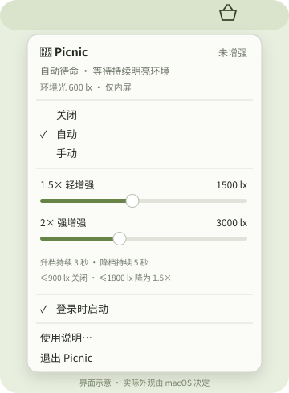

# Picnic: setup & technical notes

[← Back to Picnic](../README.md)

## Install and use

Download the Apple Silicon ZIP from [Releases](https://github.com/Guino-Yang/Picnic/releases), unzip it, and move `Picnic.app` to Applications or `~/Applications`. Open it and click the basket in the menu bar. The current app interface is in Chinese; the main controls are:

| Control | Meaning |
| --- | --- |
| 关闭 | Off; remove the boost |
| 自动 | Auto; follow ambient light |
| 手动 | Manual; use a fixed 2× boost |
| 登录时启动 | Launch at login |
| 退出 | Quit Picnic |

Regular launches start in Auto mode and keep your saved thresholds. Adjust screen brightness with the usual keyboard keys or macOS Control Center. The basket is an outline while idle and filled while boosting. Normal shutdown restores the display table owned by Picnic and removes its EDR trigger window.

To uninstall, disable “登录时启动”, quit normally, and move the app to the Trash. There is no separate background daemon or driver.

<p align="center">
  
  <br><sub>Menu illustration; the actual fonts and materials are provided by macOS.</sub>
</p>

## Compatibility and release status

Picnic targets EDR-capable Apple Silicon MacBook built-in displays on macOS 14 or later. External and mirrored displays are excluded. Hardware observations so far cover a **14-inch M1 Pro MacBook Pro running macOS 27.0.1**. Other models, system versions, display presets, HDR/DRM playback, long outdoor sessions, and sleep/unlock combinations have not been comprehensively validated.

The first public release is **2.0.0**, following earlier local iterations. It uses an **ad-hoc signature, with no Apple Developer ID signing or notarization**. macOS may block the downloaded app. You can also build from source using the instructions below; Picnic does not require disabling Gatekeeper, SIP, or XProtect. A successful signature check verifies bundle integrity, not Apple notarization.

**1.5× and 2× describe display-output gain, not calibrated physical brightness multipliers or a guaranteed 1000 nits.** Actual brightness depends on system settings, display presets, content, temperature, and hardware. Disable the boost for color-critical work, and avoid running other display-table dimming tools at the same time.

Ambient light is read through dynamically loaded, read-only IOHID interfaces that are not public APIs. System updates may affect compatibility. Picnic adds no separate pause policy for temperature, low battery, lock, or sleep; macOS display sleep and hardware protections still apply. An offline built-in display, such as when the lid is closed, cannot be boosted.

Picnic does not connect to the internet or read screen contents.

## Automatic brightness tiers

| Default activation | Gain | Release condition |
| --- | --- | --- |
| ≥ 1500 lx for 3 seconds | 1.5× | ≤ 900 lx for 5 seconds: off |
| ≥ 3000 lx for 3 seconds | 2× | ≤ 1800 lx for 5 seconds: down to 1.5× |

Each tier releases at **60%** of its activation threshold, so a brief shadow does not immediately change the gain. A sudden jump into bright light can go straight to 2×; a drop into darkness can go straight to off after 5 seconds. Transitions between gains take about 2 seconds.

The two sliders use **250 lx** increments within an overall **500–5000 lx** range. The second threshold must be at least 250 lx above the first, so the sliders constrain each other. This range limits the trigger settings, not the sensor: light above 5000 lx can still activate the boost. Manual mode is always 2× and does not require the ambient sensor.

## Build from source

Use macOS with Apple’s Xcode or Command Line Tools (`xcrun`, Swift, clang, and the macOS SDK). No third-party package manager or network dependencies are required for the local build.

```sh
git clone https://github.com/Guino-Yang/Picnic.git
cd Picnic
zsh test.sh
zsh build.sh
```

The build script prints the signed app’s local path and creates `dist/Picnic.zip`. It packages the app in a temporary directory to avoid cloud-storage metadata interfering with signing. The repository includes ready-to-use icons; run `zsh Scripts/build-icon.sh` only after replacing the source artwork.

## How it works and what was checked

Picnic applies a **256-entry CoreGraphics display transfer table** and keeps EDR active with a **1×1 logical-point Metal window** at the top-left corner, drawing at 5 fps. The window ignores mouse input and does not take keyboard focus. There is no full-screen white blending layer.

| Source | Role |
| --- | --- |
| `Sources/Policy.swift` | Tier timing, hysteresis, and threshold constraints |
| `Sources/AppModel.swift` | Sensor polling, gain transitions, and preferences |
| `Sources/DisplayGain.swift` | Display-table ownership, gain, and restoration |
| `Sources/Overlay.swift` | EDR trigger window and Metal rendering |
| `Sources/AmbientSensor.c` | Read-only ambient light sampling |
| `Sources/main.swift` | Native menu, status icon, and diagnostics |
| `Sources/LoginItems.swift` | macOS login item |

There are **97 policy and display-table checks**. GitHub Actions runs these tests and builds the app; it does not test a physical display. Manual observations covered the desktop, menus, Mission Control, brightness controls, and a simulated-light sequence driving the real screen through 1.5× → 2× → 1.5× → off. No luminance meter was used. See the [detailed test record (中文)](TESTING.md) for coverage and diagnostic options.

## Feedback and credits

Please include your Mac model, macOS version, display preset, Auto/Manual mode, and whether an external display is connected when [reporting an issue](https://github.com/Guino-Yang/Picnic/issues). You do not need to share your username, desktop screenshots, or other private information.

Code and troubleshooting were assisted by Codex; the app icon was AI-assisted. The maintainer reviews, tests, and publishes the project. Technical references and retained third-party licensing are in [NOTICES.txt](../NOTICES.txt).

[MIT License](../LICENSE) © 2026 Guino-Yang.
